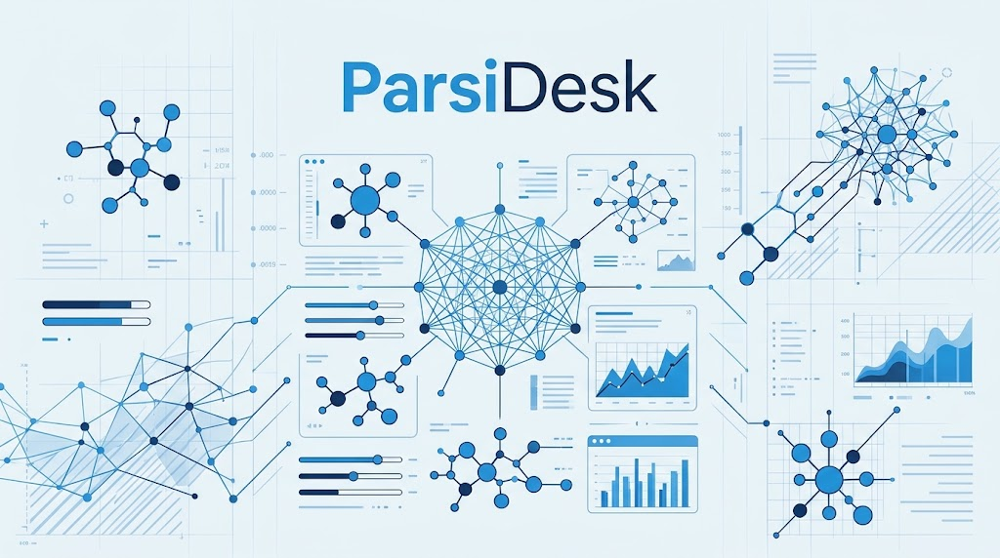

   

# ParsiDesk

**ParsiDesk** is a Persian remote desktop application made by [Parsipol.com](https://parsipol.com).
It lets you view and control another computer, transfer files and share the clipboard, with a Persian
interface and a dedicated Parsipol server.

- Website and downloads (for members): <https://desk.parsipol.com>
- Platforms: Windows 10/11 (64-bit) and Android 5.1+

## Server settings

The Windows and Android apps come preconfigured for the Parsipol server (`desk.parsipol.com`), so nothing needs to be entered
after installing. The values can be changed in the app under Settings → Network.

## License

ParsiDesk is free software, released under the GNU Affero General Public License v3.0. See [LICENCE](LICENCE).
To obtain the source code of a release, contact Parsipol at <https://parsipol.com>.
